<h1 align="center">The Chosen One</h1>

<p align="center">
  A dungeon crawler with puzzle rooms, three bosses and a tilt maze, written in Verilog for the Digilent Nexys A7-100T (VGA 640×480 @ 60 Hz).
</p>

<p align="center">
  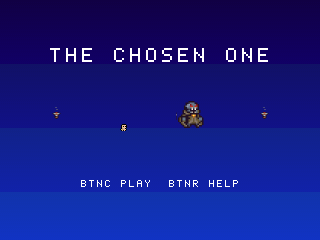
</p>

<p align="center">
  
  
  
  
</p>

The game name on screen is *The Chosen One*. This repository (`cpe222-the-chosen-one`) is the code of the final project report "Developing the Game The Chosen One on an FPGA", CPE222, KMUTT, Group 10. It was renamed from `Group10_Dungeon`; the Vivado project it creates is still named `Group10_Dungeon`.

## Contents

1. [Overview](#overview)
2. [Screenshots](#screenshots)
3. [Game at a glance](#game-at-a-glance)
4. [Controls](#controls)
5. [Hardware and software requirements](#hardware-and-software-requirements)
6. [Quick start](#quick-start)
7. [Architecture](#architecture)
8. [Repository structure](#repository-structure)
9. [Testing and verification](#testing-and-verification)
10. [Known limitations](#known-limitations)
11. [Team](#team)
12. [Credits and licences](#credits-and-licences)
13. [Documentation index](#documentation-index)

## Overview

The hero explores three floors of a dungeon. Each floor has a start room, two combat rooms, a puzzle room and a boss room. The whole game, including the VGA picture, the sound and the input handling, is written in Verilog. There is no processor.

Main features:

- **Movable player.** The hero walks in four directions with the board buttons or a USB keyboard, fights with melee or shots, and can use auto aim.
- **Sprite evolution.** Each solved puzzle gives an item. The hero then evolves into a new form with a new sprite and a new weapon (four forms in total).
- **Puzzles, bosses and a tilt maze.** Each floor has one puzzle (Light Bulb, Sokoban, Simon Says) and one boss. After the last boss, the hero rolls a ball through a maze by tilting the board.

## Screenshots

All screenshots come from the **Verilator simulation of the real design**, not from the board. Some of them use debug switches (SW0 to SW4) to skip long stretches of play. The script and frame of each picture are listed in `report_shots/README.txt`.

<table>
  <tr>
    <td align="center"><br>Title</td>
    <td align="center">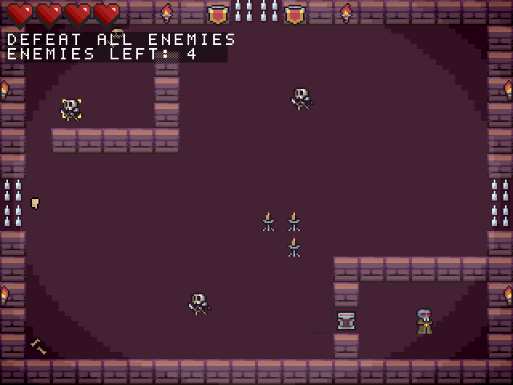<br>Combat</td>
  </tr>
  <tr>
    <td align="center">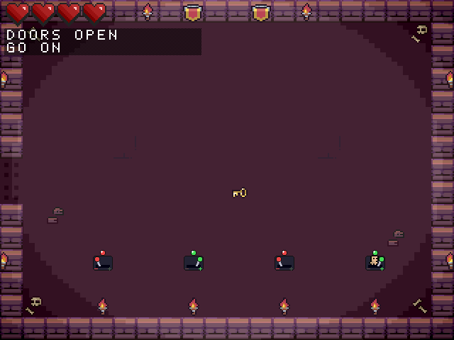<br>Light Bulb puzzle</td>
    <td align="center">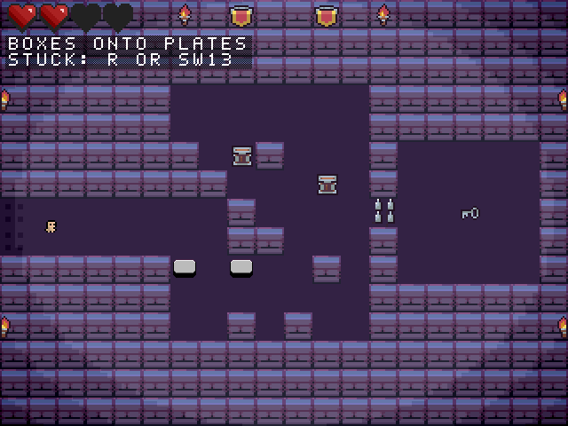<br>Sokoban</td>
  </tr>
  <tr>
    <td align="center">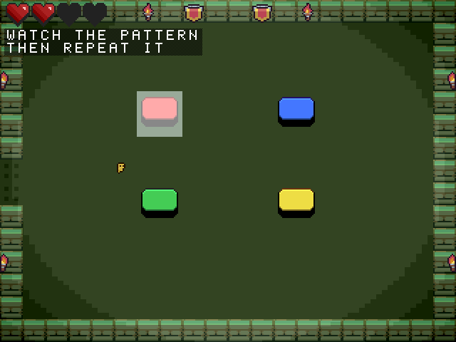<br>Simon Says</td>
    <td align="center">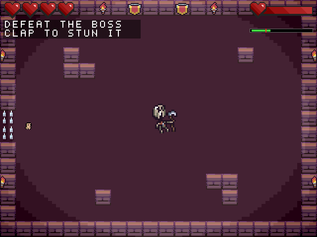<br>Boss 1</td>
  </tr>
  <tr>
    <td align="center">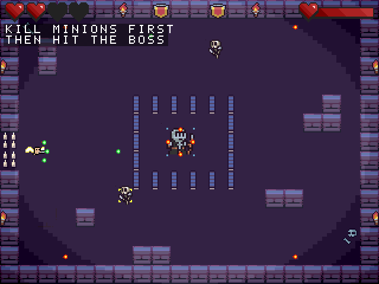<br>Boss 2</td>
    <td align="center">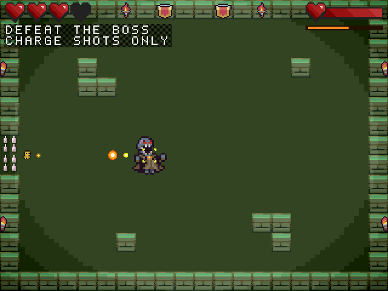<br>Boss 3</td>
  </tr>
  <tr>
    <td align="center">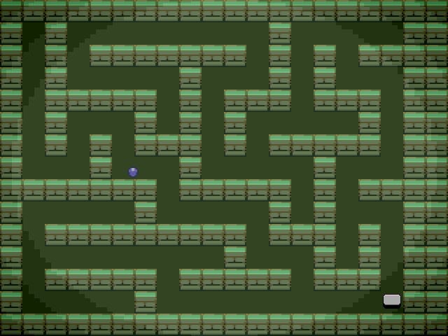<br>Tilt maze</td>
    <td align="center">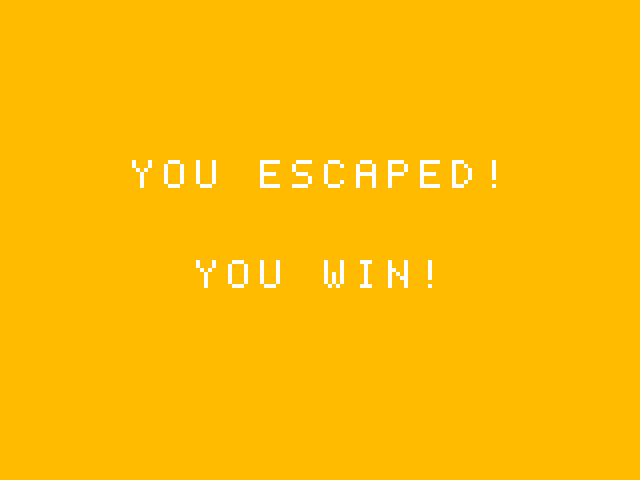<br>Win</td>
  </tr>
</table>

More pictures are in `docs/images/` (melee, shooting, room cleared, Sokoban solved, Simon solved, floor clear, game over, hero forms, enemies and obstacles).

## Game at a glance

### Structure

| Item | Value |
| --- | --- |
| Floors | 3 |
| Room roles per floor | START, Combat 1, Combat 2, Puzzle, Boss (15 rooms in play) |
| Room map files | 13 ASCII files, 20×15 tiles (`maps/00` to `maps/12`); some maps are shared |
| Ending | Boss 3 drops a key; door E in the start room of floor 3 opens the tilt maze; the maze has a 60 s limit |

### Hero forms

<p align="center">
  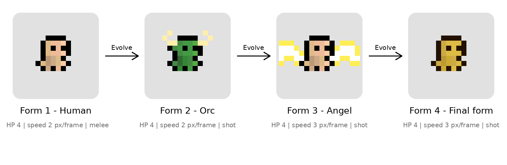
</p>

| Form | Speed (px/frame) | Max HP | Damage | Weapon |
| --- | --- | --- | --- | --- |
| 1 Human | 2 | 4 | 1 | Melee swing |
| 2 Orc | 2 | 4 | 1 | Single shot |
| 3 Angel | 3 | 4 | 2 | Three-way spread; a shot that hits a monster splits into four |
| 4 Final form | 3 | 4 | 2 | Fast shot; hold 45 frames for a large ball (damage 4) |

Form 4 uses a placeholder sprite (the Human sheets with a gold tint), see `docs/SPRITE_STATUS.md`. Values are from `rtl/params.vh`.

### Enemies, bosses and obstacles

<p align="center">
  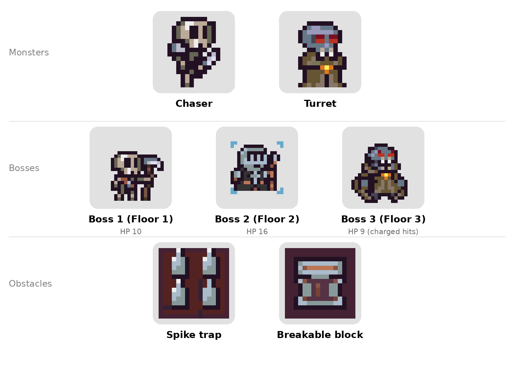
</p>

| Enemy | HP | Behaviour |
| --- | --- | --- |
| Chaser (monster A) | 2 | Walks towards the hero at half speed |
| Turret (monster B) | 3 | Fires in four directions and aims one shot at the hero |

| Boss | HP | Notes |
| --- | --- | --- |
| Boss 1 (floor 1) | 10 | Chases the hero; a clap (or SW11, or key C) stuns it for 3 s |
| Boss 2 (floor 2) | 16 | Stays inside a fence and summons minions; it can be hurt only after all minions are dead |
| Boss 3 (floor 3) | 9 | Armoured; hurt by the charged shot of form 4, or while it rests; it charges a large attack that can be interrupted |

Obstacles: spike traps (permanent on floor 3, timed on floor 2), breakable crates, pits (forms 3 and 4 fly over them) and locked doors that open when the room is clear.

### Puzzles

| Floor | Puzzle | Rule |
| --- | --- | --- |
| 1 | Light Bulb | Hit levers a to d to toggle the four bulbs until all are lit |
| 2 | Sokoban | Push both boxes onto the plates; the gate opens (shortest solution: 24 pushes) |
| 3 | Simon Says | Watch the plates light up, then repeat the pattern; three rounds of length 3, 4 and 5 |

Solving a puzzle shows an item. Picking it up evolves the hero and opens the boss door of that floor.

## Controls

The game can be played with the board alone, with a USB keyboard, or with both. The complete player guide is `docs/CONTROLS.md`.

| Board | Keyboard | Action |
| --- | --- | --- |
| BTNU / BTND / BTNL / BTNR | Arrow keys or W A S D | Walk |
| BTNC | Space, J or Enter | Start; attack; close a story box |
| BTNL (game over) | Left arrow | Back to the title screen |
| BTNR / BTNL (title) | Right / left arrow | Next / previous title page (settings, controls, credits) |
| SW15 | P or Esc | Pause |
| SW14 | Shift | Sprint (+1 px/frame) |
| SW13 (flip up) | R | Reset the Sokoban boxes |
| SW9 | L | Auto aim; on by default, SW9 up or L turns it off |
| SW12 | none | Hold the facing direction |
| SW11 (flip up) | C | Backup for the microphone clap |
| SW10 | none | Maze: use the buttons instead of the tilt sensor |
| SW8 | H | Show hit boxes |
| SW5 to SW7 | none | Adjust the clap level (0 uses the setting from the title menu) |
| CPU_RESETN | none | Reset |

Other inputs:

- **Microphone (PDM):** a clap stuns boss 1.
- **Accelerometer (ADXL362):** tilting the board rolls the ball in the maze.

**Debug switches.** SW0 to SW4 work only when `parameter DEBUG` in `rtl/top.v` is 1. The file default is **1**. The submission build must set `DEBUG = 0`. `scripts/create_project.tcl` does not set this parameter.

| Switch | Effect when `DEBUG = 1` |
| --- | --- |
| SW0 | Open the boss door and door E |
| SW1 (flip up) | Finish the floor; at door E without a key it ends the game with a win |
| SW2 (flip up) | Remove all monsters of the room |
| SW3 (flip up) | Give the item (evolve) |
| SW4 (flip up) | Lose one heart |

## Hardware and software requirements

| Item | Requirement |
| --- | --- |
| Board | Digilent Nexys A7-100T (FPGA part `xc7a100tcsg324-1`) |
| Display | VGA monitor |
| Input | Board buttons and switches; optional USB keyboard on the USB-HID port |
| Sound | Headphones or speakers on the AUDIO OUT jack |
| Synthesis | Vivado 2024.2 |
| PC simulator | Verilator 5.x, SDL2, a C++ compiler and `make` (tested with Verilator 5.054) |
| Testbenches | Icarus Verilog (tested with 13.0) |
| Art and ROM generation | Python 3 with Pillow |

## Quick start

### Get the code

```bash
git clone https://github.com/Mc4minta/cpe222-the-chosen-one.git
cd cpe222-the-chosen-one
```

### Build for the board (Vivado)

Create the project, synthesise and write the bitstream in one step:

```bash
vivado -mode batch -source scripts/create_project.tcl -tclargs build
```

The bitstream is `vivado/Group10_Dungeon.runs/impl_1/top.bit`. To create only the project, omit `-tclargs build` and run the flow in the Vivado GUI. Program the board from the Hardware Manager. The step-by-step guide is `docs/BOARD_TEST_STEPS.md`.

Before building for submission, set `parameter DEBUG = 0` in `rtl/top.v`.

### Run the testbenches (Icarus Verilog)

```bash
./scripts/run_sim.sh all          # all testbench targets
./scripts/run_sim.sh world        # one target
./scripts/check_all.sh --fast     # regenerate files, check they are up to date, run Python tests (about 1 minute)
./scripts/check_all.sh            # the same plus the full Icarus suite (about 12 minutes)
```

### Run the game on a PC (Verilator)

The simulator builds the same Verilog as the board and shows the VGA picture in an SDL2 window.

```bash
cd sim/verilator
make run        # build and open the window
make seeded     # fixed puzzle seed, used by the replay scripts
```

Headless run with a screenshot:

```bash
cd mem
SDL_VIDEODRIVER=dummy ../sim/verilator/obj_dir/Vtop --frames 300 --script "R:5:200,C:60:62" --shot shot.bmp
```

Scripted play and screenshot helpers:

```bash
./scripts/run_full_game.sh            # scripted run from title to win (about 10 minutes)
./scripts/run_sprite_shots.sh         # pictures of every form
./scripts/make_shots.sh               # render screenshots with Icarus Verilog
```

See [Known limitations](#known-limitations) for the state of the Verilator build and of the replay scripts. The `Vtop` options and the script format are described in `docs/README_detailed_reference.md`.

### Regenerate art, maps and text

Sprites, tiles, maps, text and music are generated from the files in `my_asset/`, `sprites/`, `maps/` and `docs/STORY.md`. Do not edit `mem/*.mem` by hand.

```bash
scripts/update_sprites.sh             # rebuild all art ROMs and previews
python3 scripts/build_maps.py         # rebuild map ROMs
python3 scripts/build_story.py        # rebuild on-screen text from docs/STORY.md
```

## Architecture

The design runs on one 100 MHz clock. A clock enable drives the pixel timing. The game logic advances once per frame (60 Hz).

### Game state machine

`rtl/game_fsm.v` holds the game state, the hero form and the hero HP. Pause is not a state; it stops the frame tick during play and in the maze. A hit that reduces HP to zero, or a maze timeout, leads to the game-over state.

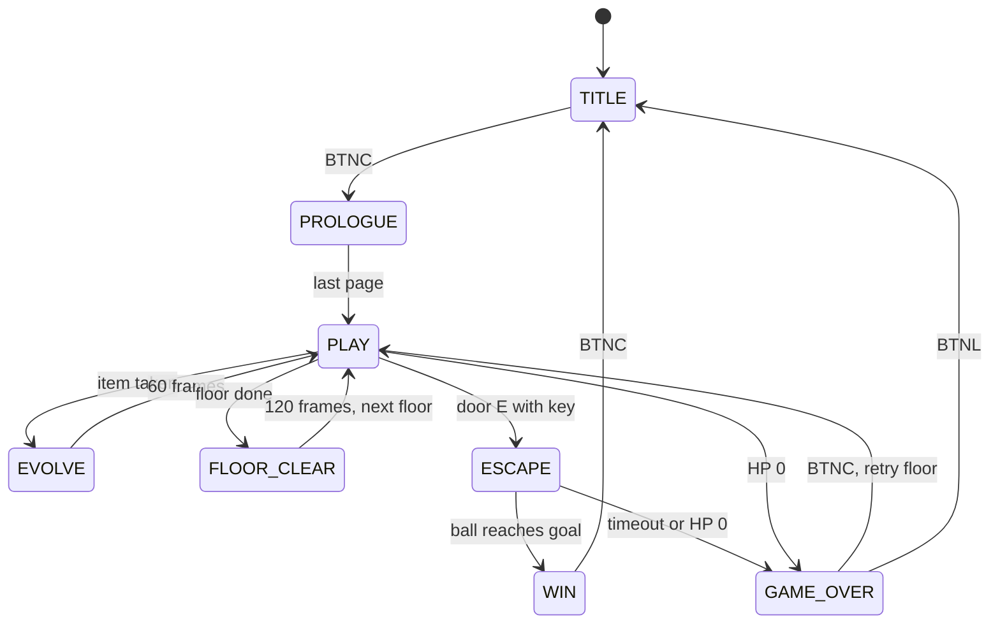

### Game engine

`rtl/top.v` connects the modules. The debounced buttons, the PS/2 keyboard, the PDM microphone and the ADXL362 sensor feed the game logic. `world.v` tracks the floor and the room. `player.v` handles movement and collision. `objects.v` holds up to six monsters, six player bullets and sixteen enemy bullets, and tests overlaps. `boss.v`, `puzzles.v` and `maze.v` implement the bosses, the three puzzles and the tilt maze. `audio.v` outputs sound effects and music as PWM.

```text
buttons / switches / PS/2 keyboard / microphone / accelerometer
        |
     top.v  -->  game_fsm  world  player  objects  boss  puzzles  maze  dialog
        |
     renderer  (tiles, objects, hero, HUD, text)  -->  VGA
     audio     (13 sound effects, music)          -->  AUD_PWM
```

### Pixel pipeline

`rtl/renderer.v` computes the colour of each pixel in a four-clock pipeline. Stage 0 applies the screen shake and computes the tile address and the text position. Stage 1 reads the tile map and registers the addresses of the tile set and of the hero sprite. Stage 2 reads the ROMs (block RAM) and takes the object layer from `objline.v`, a double line buffer that draws the objects of the next line. Stage 3 selects the layer and registers the colour. The layers, bottom to top, are tile, puzzle objects with monsters, bosses and bullets, hero, and text. The colour `F0F` marks a transparent pixel. `top.v` delays the sync signals by the same four clocks.

### Sprites and ROMs

All pictures are ROMs with 12-bit RGB444 words (`F0F` = transparent), loaded from `mem/*.mem`.

| ROM | Contents |
| --- | --- |
| `mem/player.mem` | 48 hero frames of 32×32 (4 forms × 4 directions × 3 poses) |
| `mem/monster.mem` | 4 frames of 32×32 (2 monsters × 2 frames) |
| `mem/boss.mem` | 8 slots of 64×64 (6 used: 3 bosses × 2 frames) |
| `mem/tileset.mem` | 48 tiles of 32×32 (3 floors × 16 tiles) |
| `mem/ovtile.mem` | 16 overlay pictures of 32×32 (crate, spike trap, decoration, torches, timed spikes) |

The local Vivado run of 22/11/2026 reports 103.5 of 135 block RAM tiles (101 RAMB36 and 5 RAMB18).

### Content pipeline

Art, maps, text and music are built by Python scripts into `.mem` files that Vivado loads as ROM contents. If a source file is missing, the build falls back to the original art and prints a warning.

## Repository structure

```text
rtl/            Verilog sources; files named *_cfg.vh, puzzle_layout.vh, text_*.vh and tilebase.vh are generated
constraints/    nexys_a7.xdc (pins and clock), mic_test.xdc
maps/           13 ASCII room maps and maps/maze/maze.txt; maps_v1/ holds the originals
mem/            generated ROM files; *_v1.mem are the original art
sprites/        JSON settings for the art and music pipelines
my_asset/       source art
scripts/        ROM builders, Vivado Tcl scripts, simulation and check scripts
tests/          Python tests for the pipelines
sim/            Icarus testbenches (tb_*.v) and the Verilator player (sim/verilator)
report_shots/   scripts, key scripts and screenshots made with Verilator for the project report
docs/           documents, images (docs/images), recorded audio (docs/audio)
preview/        generated preview pictures
```

The `vivado/` folder is created by `scripts/create_project.tcl` and is not part of the source. `my_audio/` (source audio) is not committed.

## Testing and verification

**Testbenches.** The testbenches in `sim/` run with Icarus Verilog through `scripts/run_sim.sh`. A target passes when its log has no `FAIL` and no `errors = N` with N above zero.

| Area | Targets |
| --- | --- |
| Hero and world | `player`, `playerframe`, `facelock`, `world`, `fsm` |
| Objects and combat | `objects`, `orb`, `boss` |
| Puzzles and maze | `puzzles`, `simonplate`, `maze`, `adxl` |
| Display and text | `hud`, `dialog`, `text`, `ovrender` |
| Input and sound | `ps2`, `mic`, `mictop`, `audio` |
| Art ROMs | `sprites`, `tileset`, `monster`, `bosssprites`, `puzzleart`, `animroms` |
| Whole system | `debug`, `top`, `topanim` |

**Python tests.** `tests/` has one test file per generation pipeline (sprites, tiles, monsters, bosses, puzzle objects, HUD, overlay, maps, story, music) and a fallback drill. The files use `unittest`, so both `python3 -m pytest tests -q` (needs `pip install pytest`) and `python3 -m unittest discover -s tests -p 'test_*.py'` run them. `scripts/check_all.sh` runs them too. Running the tests regenerates `mem/*.mem` and `rtl/puzzle_layout.vh`; check `git status` afterwards.

**Full-game simulation.** A scripted run from title to win exists (`scripts/run_full_game.sh`). It was not rerun on the latest code (see limitations).

**Board.** The project team reports that the full game was played on a Nexys A7-100T and works. The repository itself records board results only for the USB keyboard (`docs/BOARD_TEST_STEPS.md`, `docs/CHANGE_REVIEW.md`); everything else listed there is marked "board: not tested" and is verified in simulation only.

## Known limitations

1. **Timing is not met at 100 MHz.** The implemented design in Vivado reports the following (`top_timing_summary_routed.rpt`, run of 22/11/2026):

   | Metric | Value |
   | --- | --- |
   | Worst negative slack (WNS) | -4.045 ns |
   | Total negative slack (TNS) | -2904.290 ns |
   | Failing setup endpoints | 1853 of 9926 |
   | Worst hold slack (WHS) | +0.046 ns (hold is met) |

   The same run reports 18,182 of 63,400 slice LUTs and 103.5 of 135 block RAM tiles. The worst path ends in the renderer text address. Despite the failed constraint, the design ran on the board. Timing has not been fixed.
2. **Test status of the last run (23/11/2026, Icarus Verilog 13.0).** `tb_player` reports 2 failed checks (`form1 blocked by hole`, `spd4: form1 still blocked by hole`). Six targets (`simonplate`, `ovrender`, `text`, `orb`, `debug`, `top`) do not compile with Icarus 13.0, because `rtl/renderer.v:162` uses the name `inside`, which is a keyword in SystemVerilog mode. The other 12 targets pass. Of 165 Python tests, one fails (`test_overlay_pipeline`, a byte comparison of `mem/ovtile.mem`; the checkout has CRLF line endings and the regenerated file has LF). The results are in `test_output_full.txt`.
3. **`DEBUG` defaults to 1.** The debug switches SW0 to SW4 are active in a default build. Set `DEBUG = 0` for the submission build.
4. **Verilator build.** With Verilator 5.054, the unmodified `sim/verilator/Makefile` did not build in our WSL setup. The identifier `inside` in `rtl/renderer.v` is read as a SystemVerilog keyword, and the Makefile passes `-GPROLOGUE=$(PROLOGUE_V)` while `PROLOGUE_V` is never defined. The screenshots were made with a command-line override (`--default-language 1364-2005`, `-GPROLOGUE=0`); see `report_shots/_build.sh`.
5. **Old replay scripts.** The scripts in `sim/verilator/scripts/` (including `full_game.txt`) were written before the story boxes and the room redesign. They no longer reach the end of the game. The scripts used for the report pictures are in `report_shots/scripts/`.
6. **Not confirmed on the board:** the `AUD_SD` level against the board manual, and the tilt direction of the maze (`MAZE_SIGN_X`, `MAZE_SIGN_Y` in `rtl/params.vh`). Both are open items in `docs/BOARD_TEST_STEPS.md`.
7. **Art.** The form 4 hero sprite is a recoloured placeholder. Bullets and the melee slash use the original simple art. See `docs/SPRITE_STATUS.md`.
8. **Music.** The background music uses the melody of the song "Connect", which is copyrighted. Check this before making the repository public (`mem/music.mem`, `sprites/music/connect.txt`).
9. The pictures `docs/p*.png` were taken before the latest changes and may not match the current look of the game. The pictures in `docs/images/` are current.

## Credits and licences

The repository has no `LICENSE` file. No licence is stated for the project itself.

See [CREDITS.md](CREDITS.md) for the art packs (name, author, itch.io page, licence, use). The same credits are shown in the game on the title screen (BTNR to page through SETTINGS, CONTROLS 1-5 and CREDITS 1-8). **Minifantasy Dungeon is free for non-commercial use only and its author asks for a link to the finished project.**

Third-party material is included in `my_asset/`. Items that [CREDITS.md](CREDITS.md) does not cover are listed below as **licence not recorded**.

| Item | Where | Licence |
| --- | --- | --- |
| 2D Pixel Dungeon Asset Pack v2.0 (tiles, props) | `my_asset/2D Pixel Dungeon Asset Pack v2.0.zip`, `my_asset/tileset/`, `my_asset/props/` | Pixel_Poem, free and commercial use ([CREDITS.md](CREDITS.md)) |
| Enemy Animations Set (skeleton and vampire sheets) | `my_asset/Enemy_Animations_Set.zip`, `my_asset/enemies/` | Licence not recorded |
| Hero sheets (Human, Orc, Angel) | `my_asset/Character/` | Source not recorded in the repository (CREDITS.md lists Minifantasy Dungeon, non-commercial only) |
| Hearts and health bar | `my_asset/ui/Hearts/` | VampireGirl, CC0 ([CREDITS.md](CREDITS.md)) |
| UI sheet "MediavelFree" (not used by the game) | `my_asset/ui/MediavelFree.png` | Licence not recorded |
| Orb sprites for the maze ball | `my_asset/ball/` | axiale, free, credit appreciated ([CREDITS.md](CREDITS.md)) |
| Song "Connect" (melody entered as notes) | `sprites/music/connect.txt` | Copyrighted song; permission not recorded |

Tools: Xilinx Vivado, Verilator, Icarus Verilog, SDL2, Python with Pillow.

## Documentation index

| Document | Content |
| --- | --- |
| [docs/README.md](docs/README.md) | Project guide: which document to read, folder map, workflow |
| [docs/CONTROLS.md](docs/CONTROLS.md) | Player guide: buttons, switches, keys |
| [docs/FEATURES.md](docs/FEATURES.md) | Every implemented feature by category |
| [docs/BOARD_TEST_STEPS.md](docs/BOARD_TEST_STEPS.md) | Vivado steps and board test checklist |
| [docs/BOARD_DAY.md](docs/BOARD_DAY.md) | Board day notes, microphone test project |
| [docs/DESIGN_PLAN.md](docs/DESIGN_PLAN.md) | Design plan and status of every work item |
| [docs/NEXT_STEPS.md](docs/NEXT_STEPS.md) | Backlog by priority |
| [docs/PROGRESS.md](docs/PROGRESS.md) | Progress log |
| [docs/CHANGE_REVIEW.md](docs/CHANGE_REVIEW.md) | Changes and how they were verified |
| [docs/GAMEPLAY_REVIEW.md](docs/GAMEPLAY_REVIEW.md) | Story and gameplay review |
| [docs/MAP_DESIGN.md](docs/MAP_DESIGN.md) | Room design rules |
| [docs/STORY.md](docs/STORY.md) | Source of all on-screen text |
| [docs/SPRITE_STATUS.md](docs/SPRITE_STATUS.md) | Which sprites are final or placeholders |
| [docs/SOUND_PLAN.md](docs/SOUND_PLAN.md) | Sound effects and music |
| [docs/SOUND_PIPELINE_PLAN.md](docs/SOUND_PIPELINE_PLAN.md) | Audio import pipeline plan |
| [docs/DOC_UPDATE_REPORT.md](docs/DOC_UPDATE_REPORT.md) | Report of the last documentation refresh |
| [docs/README_detailed_reference.md](docs/README_detailed_reference.md) | Previous detailed README (tables, simulator options, sound list) |
| [docs/archive/SPRITE_PLAN.md](docs/archive/SPRITE_PLAN.md) | Old sprite plan (history) |
| [sprites/README.md](sprites/README.md) | How to change sprites, tiles, enemies and bosses |
